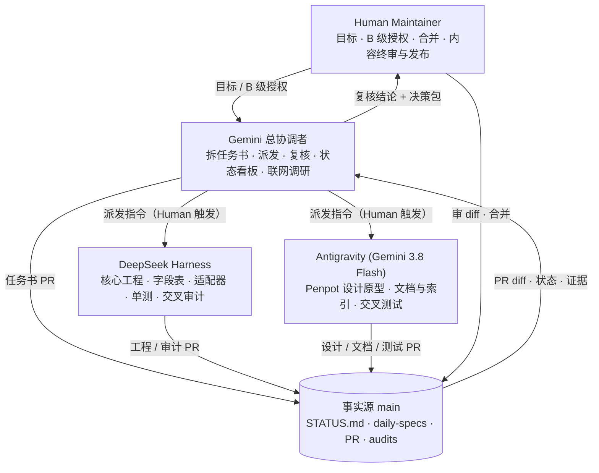
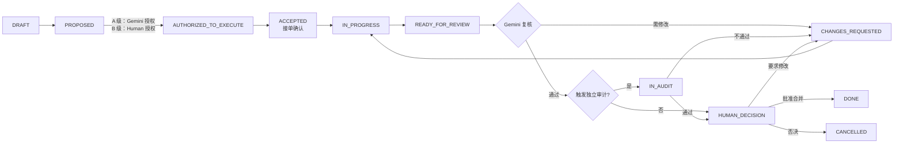

# AI Agent 开发与协作规范（V2.0）

> **状态：V2.0 拟生效（LD-GOV-03，待 Human 合并 PR 生效）**；上一版本 V1.0 已生效（PR #3，merge commit `3ea52c0`，2026-11-07；LD-GOV-02 修订见 PR #7，merge commit `9551b6e`）。
> 本次 V2.0 修订由 Gemini（总协调者）依 Human 2026-11-22 授权起草（任务 [LD-GOV-03](docs/daily-specs/LD-GOV-03.md)），Human 书面豁免本轮独立审计（决策记录 D-025、D-026）。
> **主要架构调整（相对 V1.0）**：总协调者由 Claude 迁移为 **Gemini**；**ChatGPT 网页版退出协作架构**（取消“仓库操作员”中转角色）；**Codex 移出主协作表**，将 DeepSeek Harness 与 Antigravity（Gemini 3.8 Flash）在 D-011～D-015 中已落地的实际分工正式转正；独立审计改为**架构内交叉独立审计**。

本规范适用于 LexAIDaily 仓库的全部 AI Agent 与贡献者，采用 **协调者调度 → 单任务负责人（Single Owner）→ 交叉复核（Cross Review）→ 人工验收（Human Gate）**。角色分工不授权自动合并，也不替代 Human Maintainer 的内容终审与发布决定。协调者的日常操作细则见 [协调者操作手册](docs/COORDINATOR_PLAYBOOK.md)，仓库协作与治理规则冲突时以本文件为准；总协调者的对话输出与单轮决策汇报格式以 [GEMINI.md](GEMINI.md) 为准。

## 1. 参与方与权限

| 角色 | 接入方式 | 核心责任 | 权限边界 |
|---|---|---|---|
| **Human Maintainer（兼内容运营者）** | 本人（`fitalex`） | 目标与重大决策；B 级任务授权；PR 验收与合并；资讯精选、实务点评、双端发布终审；视觉验收；法律专业判断及署名；审计豁免权 | AI 不得代签、代批、代发布、自动合并 |
| **Gemini（总协调者）** | Gemini 会话（本地独立仓库克隆 + GitHub 读写权限） | 拆分任务书；派发 A 级任务；维护状态看板；复核执行结果并出具结论；协调冲突与写入顺序；向 Human 提交决策包；起草治理与标准类文档；承担联网调研与真实样本集（如 `LD-G1-04`） | 不合并；不授权 B 级；不代签；不单方修改冻结基线；不复核自己担任 Owner 的任务（6.1）；不接触密钥；不把未核实内容写成事实 |
| **DeepSeek Harness** | 本地运行，分支 + PR | 工程主力：展示字段表、核心架构与采集/分类管线、数据契约、站点实现、公众号内联排版模板与导出脚本、信源采集适配器/解析/去重、CI、单元测试与回归、缺陷复现；担任架构内独立审计方（审计 Gemini 起草的治理/标准文档或样本）及 Gate 2 高风险资讯交叉核验 | 不得交叉测试自己实现的模块；不自行扩大范围；不直接改 `main`；不自行判定信源可信度或入库；不自行启用定时任务或付费外部服务 |
| **Antigravity（Gemini 3.8 Flash）** | 仓库内 Agent IDE（独立工作区），分支 + PR | 设计系统与 Web 桌面/移动原型（Penpot + Penpot MCP + 经授权的图像生成）；文档、索引、归档、交叉引用与版本一致性；将已定稿设计规范同步进文档；承担非自身实现模块的交叉测试（如 `LD-G1-06` 公众号排版导出结构与兼容性测试） | 不写前端业务代码；交叉测试脚本仅限任务书指定测试目录，不得改动被测业务代码；不改冻结基线、编辑原则、数据契约；不提交 Penpot 凭据；生成图须标注 AI 生成，不仿冒真实机构标识 |

> 说明：ChatGPT 网页版与 Codex 已退出当前主协作架构（历史记录保留于 [STATUS.md](docs/coordination/STATUS.md) 决策台账）。日后如需重新引入外部编码或审计 Agent，须另立 `LD-GOV` 治理任务（B 级）增补。

每项任务必须指定唯一 Owner、复核者（默认总协调者）和最终验收主体（Human Maintainer）。研究与审计报告只构成证据，不自动产生权限。

## 2. 协作架构

- **事实源是 `main` 分支。** 任务状态、决策和审计记录必须落盘到仓库（[状态看板](docs/coordination/STATUS.md)、[任务书索引](docs/daily-specs/README.md)、PR、[审计归档](docs/audits/README.md)）。对话里的结论不算数：所有 Agent 均不依赖聊天记忆，任务事实以仓库中已核验的记录为准。
- **三处记录的关系。** `main` 保存已生效的规则与已合并的状态；PR 保存待审的变更；STATUS 在合并前对应 PR 的内容只是“提议”。决策记录（D-xxx）须附 Human 原话或链接，并经 Human 在 PR 中确认后才生效；协调者起草的记录不单独构成授权。
- **派发 = 发布任务书。** Agent 之间不直接互调。Gemini 直接以分支和 PR 提交任务书与状态更新（不合并）；之后由 Human 触发执行者（对 DeepSeek Harness、Antigravity 说“执行 LD-xxx”并附任务书路径）。若日后配置了 Issue 指派等自动触发，以实际配置为准。
- **成果回收。** DeepSeek Harness 与 Antigravity 均以 PR 交回；Gemini 直接读取 PR diff、commit SHA、评论与 CI 结果进行复核；独立审计意见由审计方或协调者原文归档到 `docs/audits/`，不改写。

## 3. 任务分级与生命周期

### 3.1 任务分级

| 级别 | 条件 | 授权者 |
|---|---|---|
| **A 级** | 同时满足：在当前 Gate 已批准范围内；仅涉及文档、测试、原型、内部脚本或小型缺陷修复；不新增依赖、外部服务、凭据或费用；不改冻结基线、本规范、编辑原则或许可证；不涉及对外发布；可经 PR 回滚；与同一整体目标下的其他任务累计后仍不触及 B 级条件 | Gemini（承接经 Human 在 PR 中确认的 D-001 授权，见 D-025；须登记在 STATUS 的 A 级台账） |
| **B 级** | 满足任一：跨 Gate；新增依赖、外部 API、凭据、定时调度或产生费用；修改治理文档、编辑标准、信源白名单；许可证与第三方授权；对外发布（Web 上线、公众号发布）；读者数据或账号；改写已合并历史；涉及权限、授权分级、审计规则、治理标准的任何修改；影响内容真实性与来源判断的实质变更（见 6.1(e)） | 仅 Human Maintainer |

拿不准时按 B 级处理。判级按**整体目标和累计变更**进行，不得把 B 级任务拆成多个 A 级任务；A 级台账须写明所属整体目标。任务降级（B 改 A）和豁免独立审计，须经 Human 确认并书面记录。Human 可随时叫停任何 A 级任务。

### 3.2 状态流转

任意状态可转 `BLOCKED` 或 `CANCELLED`，须写明原因与责任方。独立审计不通过转 `CHANGES_REQUESTED`，由原 Owner 在原 PR 修复，修复后按审计者要求增量复审；Human 要求修改或否决时同样处理，不得标记 DONE。**接单确认（Ready Check）**：执行者开工前确认范围清晰、输入齐全、DoD 可验证、文件范围无冲突；有问题则拒单并写明原因，由 Gemini 修订任务书，执行者不得自行改范围。

## 4. 任务书规范

任务书存于 `docs/daily-specs/<任务号>.md`，按 [任务书模板](docs/templates/TASK_BOOK.md) 编写，必须写明：级别、Owner、复核者、是否触发独立审计、基准 commit 与分支、依赖、输入与输出、可改与不可改的文件范围、非范围、冻结边界、逐项可验证的 DoD（并标明对应所属 Gate 验收标准的哪一条）、验证命令与证据要求、升级条件。

任务号规则：阶段工程任务 `LD-G<Gate>-<两位序号>`（如 `LD-G1-02`）；治理任务 `LD-GOV-<序号>`；内容线任务 `LD-OPS-<序号>`；修订追加字母后缀（如 `LD-G1-02B`）。

分支命名：
- Gemini（总协调者）：`gemini/<任务号小写>-<slug>`
- DeepSeek Harness：`ds/<任务号小写>-<slug>`
- Antigravity：`ag/<任务号小写>-<slug>`
- 历史 `claude/`、`codex/` 分支保持不变，不再新建。

## 5. 工作分配

| 工作内容 | Owner | 复核 | 独立审计 / 最终决定 |
|---|---|---|---|
| 本规范及权限、授权、治理类文档 | Gemini（起草） | — | DeepSeek Harness 审计（或 Human 指定非起草者，必须；Human 可书面豁免）；Human 批准 |
| 任务书拆分与派发 | Gemini | 执行者接单确认 | B 级由 Human 授权 |
| 编辑原则细则、信源白名单与分级、分类口径 | Gemini（起草与联网调研） | — | DeepSeek Harness 审计（必须）；Human 批准 |
| 联网调研与真实样本集（竞品、信源、选题、法规背景、`LD-G1-04`） | Gemini | DeepSeek Harness 抽查核验（触发 6.1(d)，Human 可书面豁免） | Human 按需 |
| 核心工程、展示字段表、采集管线、数据契约、站点实现、公众号导出脚本、信源适配器、单测与回归、CI | DeepSeek Harness | Gemini 复核 DoD 与证据；Antigravity（或 Human 指定非实现者）按任务书执行交叉测试 | 按 6.1(a)-(e) 判断是否触发独立审计；信源可信度与入库由 Human 决定；Human 合并 |
| 设计系统、Web 桌面/移动原型（Penpot MCP + 图像生成） | Antigravity（Gemini 3.8 Flash） | Gemini 复核；不写前端业务代码 | 使用外部工具/第三方字体与素材按 6.1(c)（Human 可书面豁免）；执行者提供截图、Penpot 导出备份与素材来源记录；Human 视觉验收 |
| 文档、索引、归档、版本一致性与指定交叉测试（如 `LD-G1-06`） | Antigravity | Gemini 复核；技术事实由模块 Owner 确认 | 测试脚本仅限任务书指定测试目录，不得改动被测代码 |
| 每日内容线（Gate 2 起） | 见 8.2 | 见 8.2 | Human 终审 |

同一模块的实现者与交叉测试者不得是同一 Agent。DeepSeek Harness 的多个工程大任务按依赖串行，不并行压入冲突模块。正式采集数据契约属 Gate 2；Gate 1 只定义供 UI 使用的展示字段，如需提前须由 Human 批准调整 Gate 范围。

## 6. 独立审计规则

6.1 **定标准者不独审（架构内交叉独立审计）。** Gemini 兼任协调者与标准起草者。下列事项不得由 Gemini 单独审定，必须由**非起草、非实现的另一 Agent**（默认：Gemini 产出由 DeepSeek Harness 审计；DeepSeek 工程由 Antigravity 或 Gemini 复核，涉及 6.1(c)/(e) 需独立审计时由 Antigravity 或 Human 指定方审计；Antigravity 产出涉及 6.1(c) 时由 DeepSeek Harness 审计）出具独立审计意见，并与协调者复核意见分别记录，不合并成一句“已审计”：
- (a) 本规范及权限、授权、治理类文档；
- (b) 编辑原则细则、信源白名单与分级、分类口径等“标准”类文档；
- (c) 涉及密钥、权限、外部服务与费用、第三方授权与版权、发布流程的工程与设计变更；
- (d) 任何由 Gemini 担任 Owner 的任务；
- (e) 影响内容真实性、来源判断、法律风险提示和人工审核流程的实质变更，包括数据契约的字段语义、分类逻辑、信源权重与分级、AI 提示词。

Human 可对任何任务追加审计；仅 Human 可豁免，且须在任务书或 PR 中书面记录理由。协调者不得省略或自行豁免。

6.2 **审计意见格式。** 使用 [复核与审计报告模板](docs/templates/REVIEW_REPORT.md)：审计对象及基准 commit、检查范围、按严重程度排序的发现、未检查项、建议结论（通过 / 需修改 / 需人工决策）。审计意见只构成证据，不自动产生权限。审计意见须以文件形式原样归档到 `docs/audits/`（由审计方或协调者提交，不改写），PR 评论只作通知；文件与评论不一致时交 Human 裁决。**审计证据约束：** (a) PR 通知评论须包含审计结论、被审 commit SHA、归档文件的固定链接（permalink，含 commit）及该文件的 Git blob SHA；(b) 已归档的审计文件不得修改，新一轮审计另存新文件，勘误以新文件说明；(c) Gemini 读取归档文件后核对 blob SHA，并记入 `docs/audits/README.md`；(d) Human 在最终批准前核对归档版本与 PR 评论原文一致。无法核对的审计意见不得作为通过依据。

6.3 **分歧处理。** Gemini 与独立审计者的意见不一致时，任何一方不得单方裁定。原 Owner 在原 PR 回应，Gemini 列出分歧点交 Human 决定。

6.4 **跨 Agent 审计与联网调研边界。** 所有 Agent 不依赖聊天记忆，审计与调研只依据仓库已落盘记录、任务书及（需要时）交接包中的材料工作。联网调研与审计输出必须标明一手来源链接与不确定性，未经核实的事实不得入库。

6.5 **协调者自我约束。** A 级授权全部登记公示，Human 定期抽查；Gemini 不得因进度压力降低 DoD、跳过审计触发条件或在未取得证据时宣称“已通过”；Human 可随时指定其他 Agent 抽查协调记录本身。

6.6 **原“仓库操作员规则”已废止（LD-GOV-03）。** 原由 ChatGPT 网页版承担的仓库操作员角色随其退出而取消；Gemini 协调者已具备直接建分支与提 PR 能力，仍严格遵守不合并、不审批、不修改分支保护与仓库设置的约束。

## 7. 协调者职责边界

Gemini 负责：拆分任务书、判定级别与审计触发、选择执行者、派发、接单确认、结果复核、维护 STATUS 看板、协调同文件写入顺序、向 Human 提交决策包与阶段汇报、承担联网调研与样本集。Gemini 不负责也不得代行：合并、B 级授权、代签、对外发布、修改冻结基线。Gemini 默认不实现自己复核的任务；如须担任 Owner（如治理文档或联网调研），该任务适用 6.1(d)。Gemini 的任务书与状态更新须以分支和 PR 落盘到仓库，未落盘的变更不算数。

## 8. 两条工作线

### 8.1 工程线（Gate 1 至 Gate 4）

按第 3 至 7 节执行；各 Gate 的目标与验收标准以 [ROADMAP.md](ROADMAP.md) 和 [README.md](README.md) 为准，两者不一致时交 Human 裁决。

### 8.2 每日内容线（Gate 2 起启用，当前为草案）

| 步骤 | 负责 | 产出 | 门槛 |
|---|---|---|---|
| 1 采集与初筛 | 采集管线（DeepSeek Harness 负责架构、适配器与测试） | 候选池、分类、AI 初稿 | 仅取自信源白名单；每条带一手链接 |
| 2 编辑质检 | Gemini | 逐条质检标注（不改写事实） | 通过质检清单（见手册第 8 节） |
| 3 高风险二次核验 | DeepSeek Harness 交叉核验（或并入 Human 终审） | 核验备注（含发布机构、发布日期、文件版本、效力状态） | 触发：立法、监管、司法文书、处罚、融资并购金额、涉及具体当事人的负面事实 |
| 4 精选、点评与终审 | Human | 勾选结果、实务影响锚点、锐评 | AI 生成的实务影响在 Human 确认前标注“AI 初稿” |
| 5 双端发布 | Human | Web 更新、公众号栏目 | AI 不自动发布；公众号后台凭据不交给 Agent |
| 6 归档与索引 | 管线与 Antigravity | 历史归档、标签索引 | 与已发布内容一致 |

红线：无一手信源链接不入选；严格区分“已证实事实 / 官方数据 / 市场观点”；仅摘要加链接，不整篇转载（待 Human 确认）；任何法律结论须由 Human 或具备资格的专业人士作出；链接可访问不等于信息准确、现行有效，无法核实发布机构、日期、版本或效力状态的法律信息不得写成确定事实，须标“未核实”。

## 9. 并行与冲突

并行任务从最新 `main` 各自建独立分支和 PR，不共享可写分支。涉及同一文件、数据契约或设计令牌时，由 Gemini 先定写入顺序与基准 commit。路径默认归属如下（随目录形成而调整，由 Gemini 经任务书更新）：

| 路径 | 默认 Owner |
|---|---|
| `AGENTS.md`、`GEMINI.md`、`CLAUDE.md`（迁移指引）、`docs/coordination/`、`docs/daily-specs/`、`docs/templates/`、`docs/audits/` | Gemini |
| `README.md`（定位与路线图段落为冻结基线，仅 Human 可改）、其余 `docs/`、`design/`（设计令牌、Penpot 链接、导出备份与截图，不含展示字段表）、任务书指定的交叉测试目录（如 `tests/wechat-prototype/`） | Antigravity |
| `src/`、`scripts/`、`tests/`（不含指派给 Antigravity 的交叉测试目录）、`data/`、`.github/workflows/`、`design/card-fields-*`（展示字段表）、信源适配器与解析/去重模块 | DeepSeek Harness |

任务需改动他人归属的文件时，须在任务书“文件范围”中写明，并由 Gemini 协调顺序。

## 10. 工程规则

1. `main` 为稳定分支；实质变更一律经 PR。不得直接推送 `main`、强制推送、自动合并或覆盖他人工作。
2. [README.md](README.md) 与 [ROADMAP.md](ROADMAP.md) 中的产品定位、双端形态、编辑原则、Gate 路线图及验收标准是 Human 冻结基线，Agent 不得自行修改；冲突交 Human 裁决。验收清单只能转写冻结基线中的既有验收标准，不得新增、降低或改写；发现差异只报告，由 Human 决定。
3. 以当前 Gate 与任务书授权为界，不预建后续 Gate 的空模块。Gate 严格串行：前一 Gate 经 Human 正式验收前，不得开始下一 Gate 的实质研发，只允许起草任务书等准备工作。正式采集数据契约属 Gate 2，Gate 1 只定义供 UI 使用的展示字段；提前实施须 Human 批准调整 Gate 范围。
4. 新增依赖、外部 API、凭据、定时调度或产生费用的服务均属 B 级，须说明必要性并经 Human 授权。
5. 验证如实：PR 前运行任务书规定的检查，如实记录命令、结果与未执行项。CI 以实际运行为准；因路径过滤等原因未触发时，写“CI 未触发”，不得写成通过。
6. 密钥、账号凭据、读者私域数据不得进入仓库、PR、Issue 或日志。
7. 每条资讯必须保留一手信源链接；第三方材料遵循各自授权（复用策略见 STATUS 决策 D-008）。仓库许可证尚未设定，由 Human 决定，在此之前 Agent 不得添加或声明许可证。
8. AI 生成的摘要、实务影响与点评，在 Human 确认前一律标注“AI 初稿”；不得把 AI 预审写成法律意见或人工批准。
9. 不得编造链接、来源、数据、测试结果或审批记录。
10. 设计以开源方案 **Penpot** 为设计源（D-013），仓库 `design/` 保存 Penpot 链接与文件版本、导出备份、导出的设计令牌与截图；图像生成素材（如 Nano Banana，D-014）须记录生成方式、提示词、来源与授权情况，标注 AI 生成，不得生成真实人物肖像或仿冒真实机构标识；Penpot 凭据不入库。

## 11. 人类决策文件写法

凡需要 Human 审核、确认、授权或决定合并的落盘仓库文件（任务书、Issue、PR、审核报告），使用通俗简洁的中文，先说明要决定的事项，不把查找入口和理解流程的工作转给 Human。每份须附可勾选的工作清单，逐项写明：

- **工作目标**：要作出的具体决定与完成标准；
- **工作链接**：需要查看或操作的页面、文件，优先直达链接，没有现成入口时明确写明；
- **执行步骤**：按顺序说明在哪里操作、核对什么、如何提交决定。

仅列当前必要的人工动作，写明 AI 不得代签、代批的边界。本节清单格式适用于落盘仓库的持久化决策文件；总协调者在对话中的口头汇报与单轮决策收口，按 [GEMINI.md](GEMINI.md) 的单决策与受控短句规范执行。

## 12. PR 与交付

统一流程：**任务书 → 独立分支 → 实现与自测 → PR 与实际证据 → Gemini 复核 → （触发时）独立审计 → Human 决定合并**。PR 须使用 [PR 模板](.github/PULL_REQUEST_TEMPLATE.md)，记录任务号、范围、文件、依赖理由、真实命令与结果、CI 链接或“未触发”、DoD 逐项状态、待决事项。审核不通过由原 Owner 在原 PR 修复，不得用新 PR 掩盖历史问题。未合并的 PR 不写成已上线能力。

## 13. 文件地图

| 文件 | 作用 |
|---|---|
| `AGENTS.md` | 本规范（所有 Agent 默认读取） |
| `GEMINI.md` | 总协调者（Gemini）入口，指向本规范与协调者手册 |
| `CLAUDE.md` | 历史入口迁移说明（指向 `GEMINI.md`） |
| [docs/COORDINATOR_PLAYBOOK.md](docs/COORDINATOR_PLAYBOOK.md) | 协调者操作手册 |
| [docs/coordination/STATUS.md](docs/coordination/STATUS.md) | 状态看板、A 级台账、决策记录 |
| [docs/daily-specs/README.md](docs/daily-specs/README.md) | 任务书索引与编号规则 |
| [docs/templates/](docs/templates/TASK_BOOK.md) | 任务书、复核与审计报告、交接包模板 |
| [docs/audits/README.md](docs/audits/README.md) | 复核与审计意见归档 |
| [.github/PULL_REQUEST_TEMPLATE.md](.github/PULL_REQUEST_TEMPLATE.md) | PR 模板 |

## 14. 规范变更

本规范的修改经 PR 提交，依 6.1(a) 须独立审计（或由 Human 书面豁免），由 Human 批准后合并；生效与版本变更记入 STATUS 的决策记录。

- **V1.0 生效记录**：PR #3（`3ea52c0`，2026-11-07）生效，LD-GOV-02（PR #7，`9551b6e`）修正过时表述。
- **V2.0 生效条件（LD-GOV-03）**：Human 审核 diff 并在 PR 中确认 D-025、D-026 后合并即生效（本轮独立审计已由 Human 于 2026-11-22 书面豁免）。
